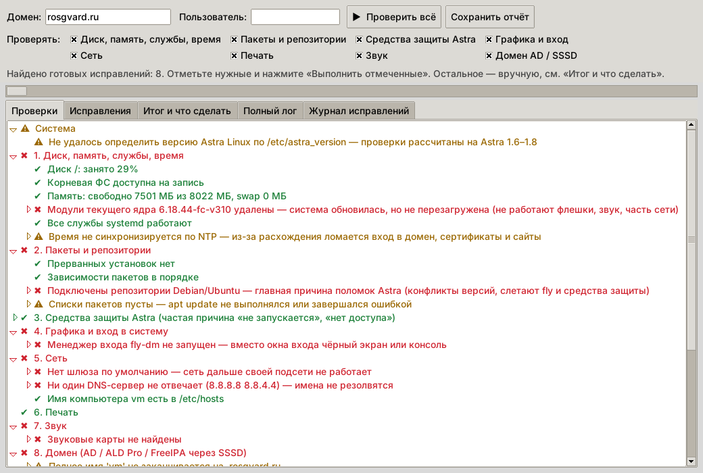
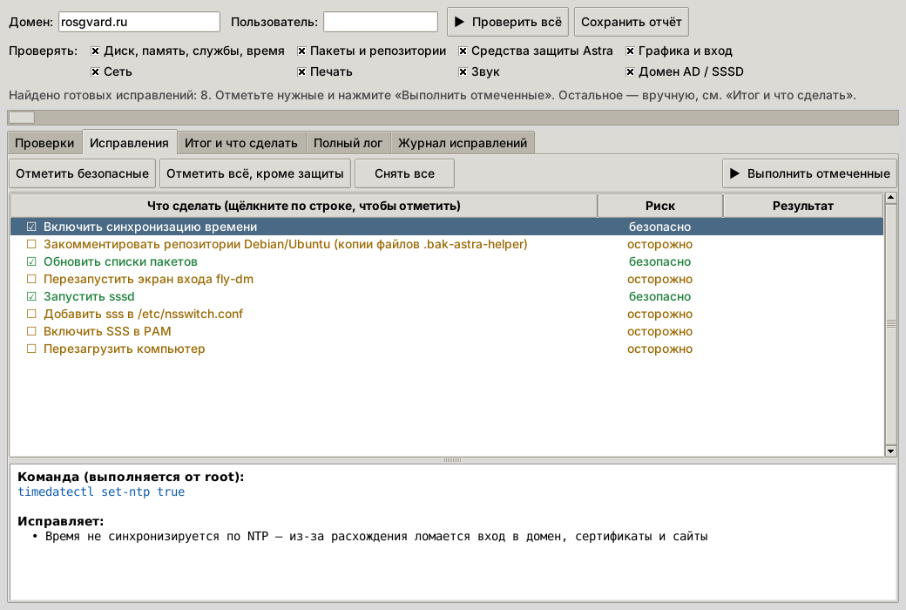
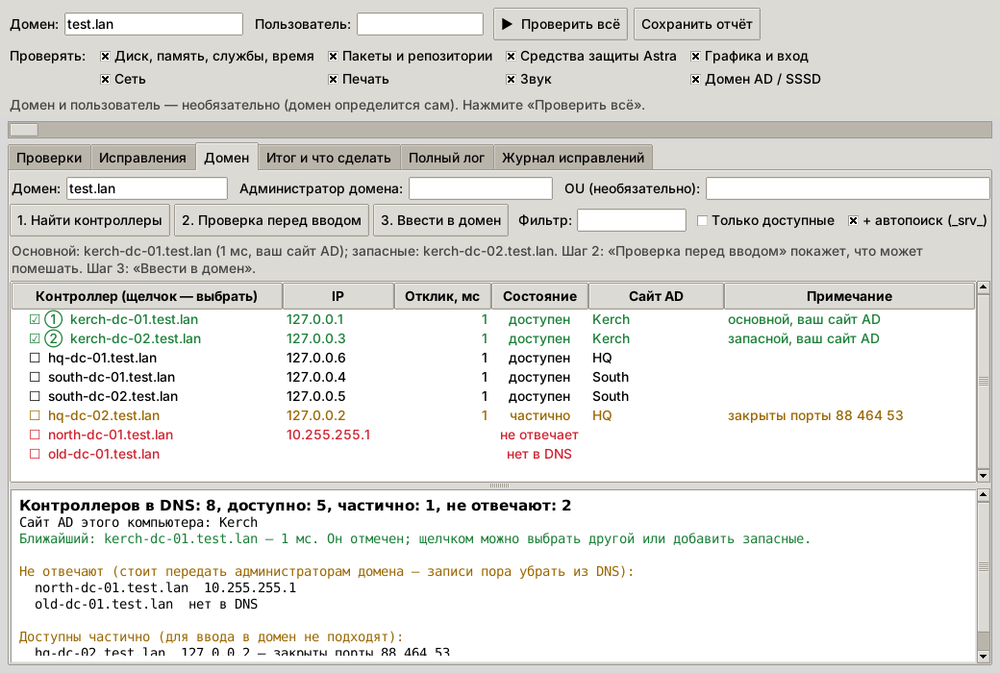

# Astra Linux Helper

Одна программа для **Astra Linux SE 1.6 / 1.7 / 1.8**, которая и диагностирует, и исправляет:

- **«Проверить всё»** — находит проблемы и показывает пошаговые инструкции. Сама проверка систему не меняет.
- **Вкладка «Исправления»** — готовые команды с галочками. Выполняются **только отмеченные** и только после подтверждения, с резервной копией настроек.

## Ввод в домен AD (вкладка «Домен»)

Для больших доменов, где контроллеров десятки, часть не отвечает, а часть находится далеко.

1. **«Найти контроллеры»** — программа берёт список из DNS, параллельно проверяет каждый контроллер и показывает таблицу: IP, отклик в мс, состояние, сайт AD. Контроллеры вашего сайта AD выделены зелёным и стоят первыми, ближайший отмечается автоматически. Щелчком выбирается другой или добавляются запасные (① основной, ② запасной…). Есть фильтр по имени и сортировка по столбцам. Система при этом не меняется.
2. **«Проверка перед вводом»** — показывает, что именно помешает вводу, и ничего не меняет: пакеты и их наличие в репозитории, имя компьютера, DNS, порты выбранного контроллера (88, 389, 464), расхождение времени, krb5.conf, отказ контроллера от SMB1 (`NT_STATUS_CONNECTION_RESET`), логин и пароль администратора домена (неверный пароль, блокировка учётки, истёкший пароль), наличие старой учётки компьютера в AD, формат OU, остатки прошлого ввода.
3. **«Ввести в домен»** — после подтверждения: копия настроек в `/var/backups/astra-helper/`, установка недостающих пакетов, `adcli join` через выбранный контроллер (без SMB), запись `sssd.conf` с выбранными контроллерами в `ad_server`, настройка krb5.conf, nsswitch и PAM, запуск SSSD и проверка. При ошибке программа объясняет причину простыми словами.

Без графики: `sudo astra-helper --domain` — те же шаги в терминале.

## Копирование текста

Текст копируется со всех вкладок: выделите мышью и нажмите Ctrl+C (работает и в русской раскладке) или используйте правую кнопку мыши → «Копировать» / «Копировать всё». В списках (проверки, исправления, контроллеры) копируется выбранная строка или весь список.

## Как работают исправления

1. Нажмите «Проверить всё». На вкладке «Исправления» появится список команд с уровнем риска:
   - **безопасно** — отмечено по умолчанию: запуск служб, разблокировка учётки после неудачных входов, `apt-get update`, включение принтера и т. п.;
   - **осторожно** — правка конфигов (`sources.list`, `krb5.conf`, `sssd.conf`, `nsswitch.conf`, `smb.conf`), сброс кэша SSSD, `apt-get -f install`, перезагрузка;
   - **⚠ защита** — отключение блокировок Astra (`astra-*-lock`). Для этих команд нужно дополнительно ввести «ДА». Выполняйте их только по решению ответственного за ИБ.
2. Щелчок по строке ставит или снимает галочку, а внизу видна точная команда и проблема, которую она решает.
3. «Выполнить отмеченные»: программа покажет список команд, сохранит резервную копию настроек в `/var/backups/astra-helper/<дата>/etc-backup.tgz` и выполнит команды. Отредактированные файлы дополнительно получают копию `*.bak-astra-helper` рядом с собой. Перезагрузка всегда выполняется последней.
4. После выполнения программа предложит проверить систему ещё раз.

Некоторые проблемы автоматически не исправляются: упавший контроллер в DNS (чистится на сервере), повторный ввод в домен (нужен пароль администратора домена), неверный DNS в сетевых настройках. Для них есть пошаговые инструкции на вкладке «Итог и что сделать».

Без графики: `astra-helper --fix`. Программа по очереди спросит `y/N` для каждой команды.

## Установка (один раз)

```bash
git clone https://github.com/atomicpel/Astra-Linux-helper.git
cd Astra-Linux-helper
sudo bash install.sh
```

Если на машине нет интернета, скачайте ZIP-архив репозитория на другом компьютере, перенесите его на флешке, распакуйте и выполните `sudo bash install.sh`.

Установщик:
- копирует программу в `/opt/astra-helper`;
- ставит недостающие зависимости **из штатного репозитория или с диска Astra** (`python3-tk`, при необходимости `dnsutils`);
- добавляет ярлык в меню «Пуск» → Системные → **Astra Helper**.

Сторонние `.deb` из Debian в репозиторий намеренно не положены. На Astra они ломают зависимости, а при включённой ЗПС вообще не запустятся, потому что не подписаны.

Если репозитория и диска нет, программа всё равно работает: при первом запуске она попробует поставить `python3-tk`, а если это не получится, выполнит все проверки в терминале.

## Установка без интернета (флешка или локальный сервер)

Готовый пакет программы лежит в `dist/astra-helper_1.3_all.deb`. Он без зависимостей и ставится на 1.6, 1.7 и 1.8. Полный офлайн-комплект: `dist/astra-helper-offline-1.3.tar.gz` (пакет и все скрипты в одном архиве, внутри есть ПРОЧТИ.txt).

Для графического окна нужен `python3-tk`. Его версия должна совпадать с вашей сборкой Astra, поэтому зависимости собираются **один раз на машине с той же версией Astra**, у которой есть доступ к репозиторию (интернет, установочный диск или ваш сервер):

```bash
cd astra-helper-offline
sudo bash collect-deps.sh        # → deps/1.8-amd64/ (или 1.6-amd64): ~10–40 МБ .deb + индекс
```

Дальше на выбор.

**Вариант 1: флешка.** Перенесите всю папку на целевой компьютер и выполните:
```bash
sudo bash install-offline.sh     # ставит только недостающие пакеты, затем программу
```

**Вариант 2: по локальной сети.** Сервер раздаёт папку как apt-репозиторий.
```bash
# на сервере (где собирали deps):
bash serve-lan.sh                # http на порту 8080; или положите папку deps в свой nginx/apache
# на каждом компьютере:
sudo bash add-lan-repo.sh 192.168.1.10
```

Если собрать зависимости негде, достаточно поставить только `.deb` командой `sudo dpkg -i astra-helper_1.3_all.deb`. Программа будет работать в текстовом режиме (`astra-helper --text`), а графика появится, как только станет доступен `python3-tk` с диска Astra.

## Запуск

- Из меню: **Astra Helper**.
- Из терминала: `astra-helper`.
- Без графики: `astra-helper --text` (проверка), `astra-helper --fix` (проверка и исправление), `astra-helper --domain` (ввод в домен).
- Без установки, прямо из папки: `bash astra-helper`.

Поля «Домен» и «Пользователь» необязательные: домен определяется сам, а пользователь нужен для проверки доменного входа и мандатных атрибутов. Проверкам нужен root, поэтому программа спросит пароль sudo.

## Что проверяется

| Раздел | Проверки |
|---|---|
| Система | версия Astra, соответствие базы Debian (9 → 1.6, 10 → 1.7, 12 → 1.8), уровень защищённости |
| Диск, память, службы, время | заполненность `/`, `/boot`, `/var`, `/home`, inode, ФС «только чтение», несмонтированные разделы из fstab, память и swap, удалённые модули ядра (не перезагрузились после обновления), упавшие службы, синхронизация времени (ntp в 1.6, timesyncd/chrony в 1.8), ошибки журнала |
| Пакеты и репозитории | прерванный dpkg, занятая база пакетов, сломанные зависимости, пустой sources.list, только cdrom, **подключённые репозитории Debian/Ubuntu**, репозиторий от другой версии Astra, CE (orel) на SE, https без `apt-transport-https` (1.6) |
| Средства защиты Astra | блокировки интерпретаторов, bash, консоли, `chmod +x`, монтирования, ptrace, макросов, выключения; ЗПС (digsig) и записи о блокировках в dmesg; МКЦ; мандатные атрибуты пользователя; блокировки учёток после неудачных входов (faillog / pam_tally2 / faillock) |
| Графика и вход | fly-dm не запущен, загрузка в консоль, ошибки Xorg («no screens found»), ручной xorg.conf, чужой владелец домашнего каталога, `.Xauthority` от root (циклический возврат на окно входа) |
| Сеть | шлюз, DNS, имя компьютера в `/etc/hosts` (тормоза sudo), конфликт `/etc/network/interfaces` с NetworkManager, доступность сервера обновлений |
| Печать | CUPS, остановленные принтеры, зависшая очередь, принтер по умолчанию |
| Звук | наличие звуковых карт |
| Домен AD / SSSD | DNS и SRV-записи, доступность каждого контроллера, **упавший DC в DNS**, время, `krb5.conf`, кэш KDC SSSD (`kdcinfo`), `sssd.conf`, режим Offline, nsswitch, PAM, smb.conf, keytab и учётка компьютера (`kinit -k`), поиск пользователя |

Изменять средства защиты (раздел 3) можно только по согласованию с ответственным за ИБ.

## Файлы

- `astra-helper` — запуск, при первом запуске ставит зависимости;
- `astra_helper_gui.py` — графическое окно: проверка и исправление (Python 3.5+, tkinter);
- `astra-doctor.sh` — все проверки, можно запускать отдельно;
- `astra-domain.sh` — поиск контроллеров, проверка перед вводом и ввод в домен;
- `install.sh` / `uninstall.sh` — установка и удаление.

## Скриншоты






